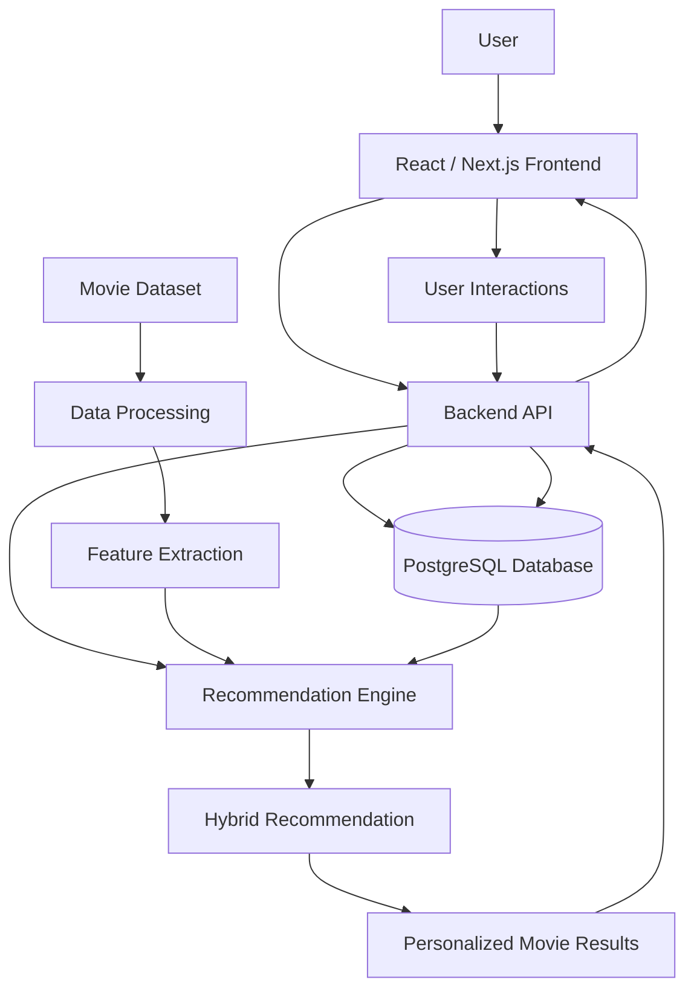

🎥 MovieRecommender

A smart movie recommendation platform that learns from your feed to suggest films you'll actually love.

## what it deals with 

#it aims to make the movie discovery feel personally and not algorithmic 

## 🎬 MovieRecommender

### Discover Movies That Match Your Taste.

**MovieRecommender** is a machine learning-powered movie recommendation platform designed to make movie discovery more personal, intelligent, and engaging.

The platform learns from users' movie preferences, ratings, viewing history, and interactions to generate recommendations that align with their individual interests.

Instead of presenting everyone with the same popular movies, MovieRecommender aims to understand what each user enjoys and help them discover films they are more likely to love.

---
# 🎬 MovieRecommender

### Discover Movies. Understand Your Taste.

**MovieRecommender** is a machine learning-powered movie discovery platform designed to make discovering films more personal, intelligent, and engaging.

The platform aims to learn from users' preferences, ratings, viewing history, and behavioral interactions to generate personalized movie recommendations.

Rather than showing everyone the same popular movies, MovieRecommender focuses on understanding individual interests, identifying meaningful patterns, and helping users discover films they are more likely to enjoy.

**Less Searching. More Discovering.**

---

## 📌 Table of Contents

- [About the Project](#-about-the-project)
- [Project Objectives](#-project-objectives)
- [Key Features](#-key-features)
- [Machine Learning Architecture](#-machine-learning-architecture)
- [System Architecture](#-system-architecture)
- [Dataset and Data Processing](#-dataset-and-data-processing)
- [Technology Stack](#-technology-stack)
- [Model Evaluation](#-model-evaluation)
- [Project Structure](#-project-structure)
- [Getting Started](#-getting-started)
- [Development Roadmap](#-development-roadmap)
- [Future Improvements](#-future-improvements)
- [Contributing](#-contributing)
- [License](#-license)

---

## 🎯 About the Project

Finding a movie to watch can become overwhelming when users have thousands of titles to choose from. Traditional movie platforms often rely on popularity, trending lists, or generic recommendations that may not reflect individual preferences.

MovieRecommender aims to address this problem by applying machine learning techniques to understand user interests and provide more relevant movie suggestions.

The platform will combine movie metadata, user ratings, and behavioral interactions to build a recommendation engine that continuously adapts to users' preferences.

### The Problem We Aim to Solve

- Too many movies and limited time to discover relevant ones.
- Generic recommendations that do not reflect individual interests.
- Difficulty discovering movies outside familiar genres.
- Recommendation systems that lack sufficient understanding of user behavior.

### Our Approach

Build a hybrid recommendation system that combines content analysis, collaborative learning, and behavioral feedback to deliver a personalized movie discovery experience.

---

## 🎯 Project Objectives

- **Personalized Discovery:** Generate movie recommendations based on individual preferences.
- **Behavioral Understanding:** Learn from ratings, clicks, watch history, and other interactions.
- **Relationship Discovery:** Identify connections between movies, genres, directors, actors, and users.
- **Recommendation Quality:** Improve the relevance and diversity of suggested movies.
- **Continuous Learning:** Incorporate new user interactions to refine future recommendations.
- **Intelligent Discovery:** Help users discover movies they might not otherwise consider.

---

## ✨ Key Features

The following features represent the planned product capabilities.

| Feature | Description |
|---|---|
| Personalized Onboarding | Establish initial user preferences through movie selections and ratings. |
| Movie Recommendations | Generate recommendations tailored to individual interests. |
| Similar Movies | Discover films with similar genres, descriptions, and characteristics. |
| Personalized Feed | Display dynamically generated movie collections. |
| User Feedback | Capture likes, dislikes, ratings, and other interactions. |
| Watchlist | Save movies for future viewing. |
| Viewing History | Track previously watched movies. |
| Recommendation Updates | Adapt suggestions as user preferences change. |

---

## 🧠 Machine Learning Architecture

At the core of MovieRecommender is a **Hybrid Recommendation Engine** combining multiple recommendation techniques.

### 1. Content-Based Filtering

Content-based filtering recommends movies by analyzing their characteristics and identifying similarities between movie items.

The system will analyze:

- Movie genres.
- Directors.
- Cast members.
- Movie descriptions.
- Keywords and tags.

**Algorithms and Techniques:**

- TF-IDF (Term Frequency–Inverse Document Frequency).
- Cosine Similarity.
- Feature Extraction.
- Text Vectorization.

**How it works:**

Movie metadata is transformed into numerical feature representations. The system calculates similarity between movies and recommends titles that share characteristics with movies a user already enjoys.

### 2. Collaborative Filtering

Collaborative filtering identifies patterns in user-movie interactions to discover relationships between users with similar preferences.

For example, when two users have similar movie ratings, the system can recommend movies enjoyed by one user to the other.

**Algorithms and Techniques:**

- Matrix Factorization.
- Singular Value Decomposition (SVD).
- User-Item Interaction Matrices.

**How it works:**

The system analyzes historical user ratings and interactions to identify latent relationships between users and movies.

Unlike content-based filtering, this approach can discover relevant movies even when their metadata is quite different.

### 3. Implicit Feedback Learning

Traditional recommendation systems often depend on explicit user ratings. However, user behavior can provide additional information about preferences.

MovieRecommender will explore behavioral signals such as:

- Movie clicks and views.
- Watch history.
- Watch duration.
- Watchlist additions.
- Likes and dislikes.
- "Not Interested" selections.

These signals will provide additional information for understanding user interests.

### 4. Hybrid Recommendation Strategy

The hybrid engine will combine content-based and collaborative filtering to leverage the strengths of both approaches.

Potential benefits include:

- Addressing cold-start challenges.
- Reducing the effects of sparse interaction data.
- Improving recommendation relevance.
- Discovering movies beyond familiar preferences.
- Adapting to changing user interests.

The combination strategy and model weights will be determined through experimentation and evaluation.

---

## 🏗️ System Architecture

MovieRecommender will follow a modular architecture that separates the user interface, backend services, data storage, and machine learning components.

### High-Level Architecture

### Main Components

| Component | Responsibility |
|---|---|
| Frontend | Movie discovery and user interaction. |
| Backend API | Business logic, authentication, and communication between components. |
| Database | Stores users, movies, ratings, and interaction records. |
| Data Processing | Cleans and prepares movie and interaction data. |
| ML Engine | Generates and ranks personalized recommendations. |
| Feedback Pipeline | Collects interactions for future recommendation improvements. |

---

## 📊 Dataset and Data Processing

The recommendation engine will initially use publicly available movie datasets for experimentation, training, and evaluation.

### Proposed Data Sources

**1. MovieLens**

A movie recommendation dataset containing user ratings, movie identifiers, and other recommendation-related information.

Website: https://grouplens.org/datasets/movielens/

**2. TMDB**

The Movie Database provides movie metadata, including descriptions, genres, cast, directors, and other movie information through its API, subject to its terms and attribution requirements.

Website: https://www.themoviedb.org/

### Data Processing Pipeline

The data preparation process will include:

1. Dataset collection and exploration.
2. Data cleaning and duplicate removal